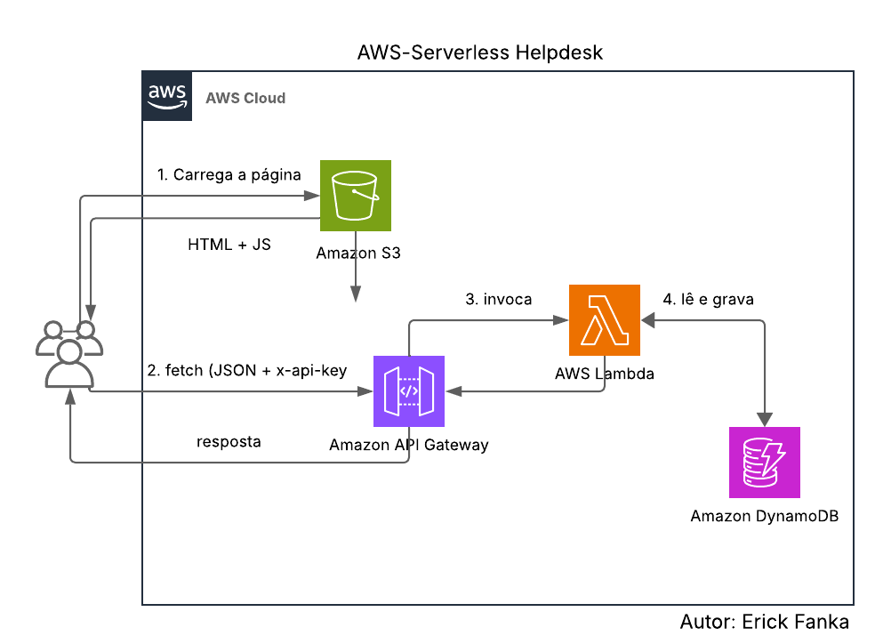
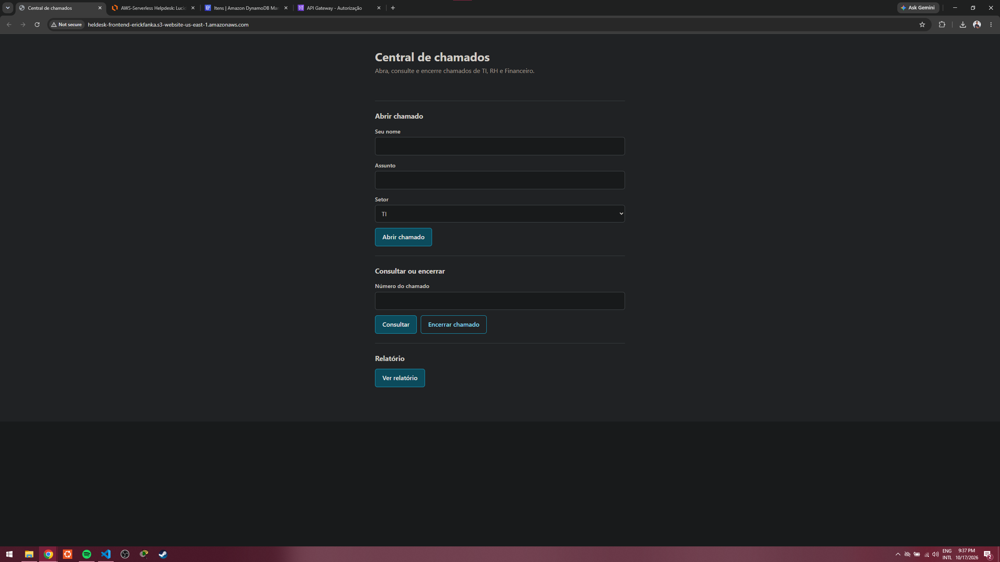
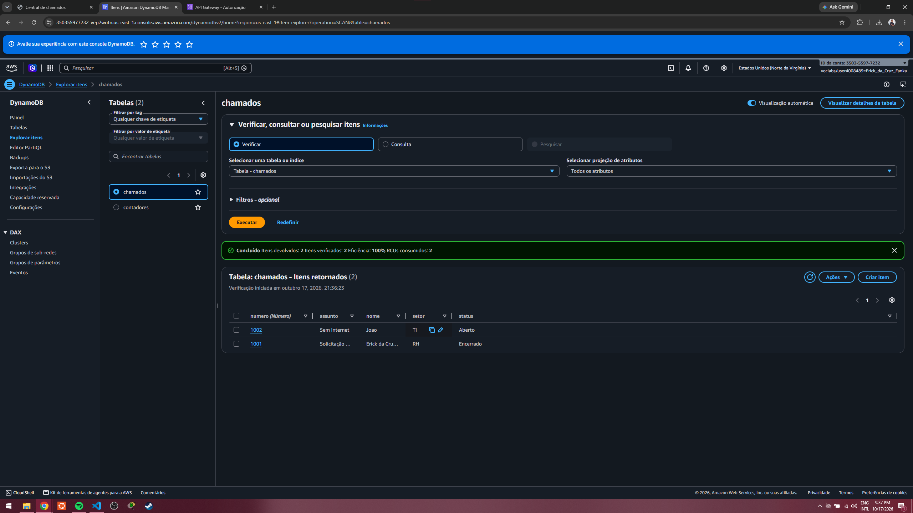
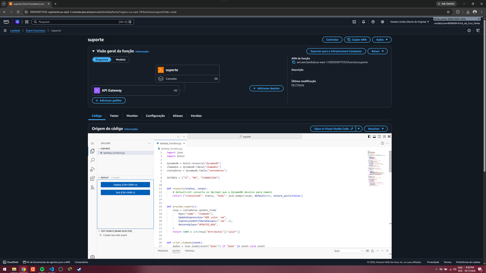
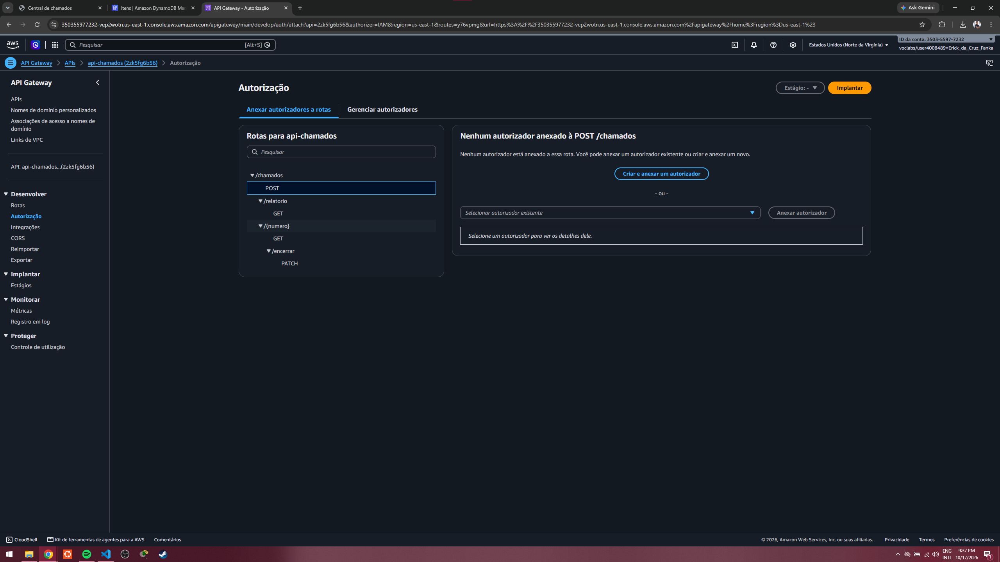
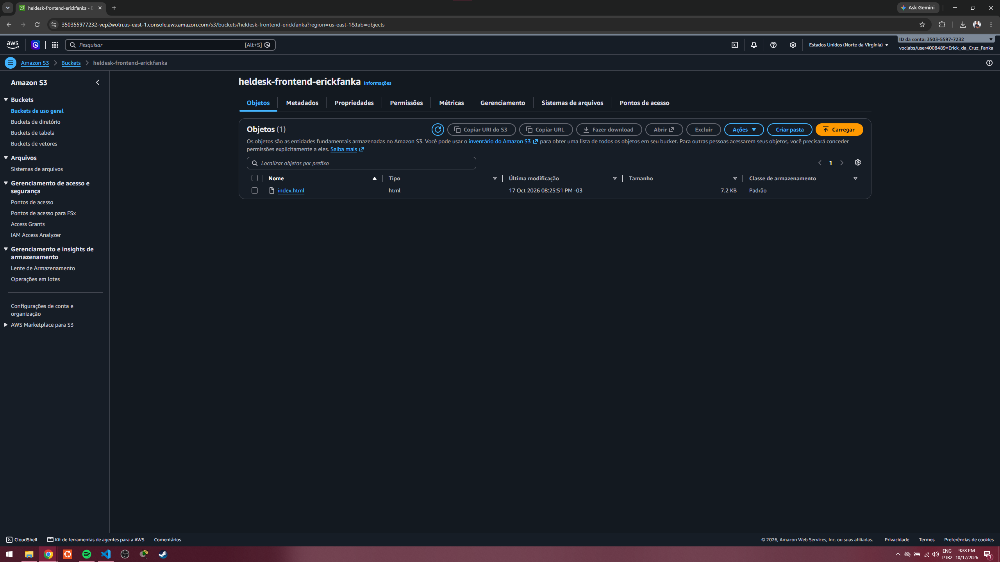

<div align="center">

# ☁️ AWS Serverless Helpdesk

**Sistema de chamados 100% serverless na AWS**

[](https://aws.amazon.com/)
[](https://www.python.org/)
[](LICENSE)
[](#)

<p align="center">
  <a href="#-sobre">Sobre</a> •
  <a href="#-arquitetura">Arquitetura</a> •
  <a href="#-rotas-da-api">Rotas</a> •
  <a href="#-aprendizados">Aprendizados</a> •
  <a href="#-roadmap">Roadmap</a> •
  <a href="#-autor">Autor</a>
</p>

</div>

---

## 🔎 Sobre

Frontend estático no **S3**, API HTTP no **API Gateway**, lógica em **Python** na **Lambda** e dados no **DynamoDB**. É a versão web de um menu de suporte que comecei no terminal com Python.

O sistema permite:

- abrir um chamado (nome, assunto e setor: TI, RH ou Financeiro);
- consultar um chamado pelo número;
- encerrar um chamado, sem permitir encerrar duas vezes;
- ver um relatório com o total de chamados por setor.

> 💡 **Projeto de estudo** feito no **AWS Academy Learner Lab**. Os recursos foram destruídos depois da demonstração, e as URLs e chaves do código estão como `COLE_AQUI_...`.
> Os nomes internos (tabelas, rotas e campos) estão em português de propósito.

---

## 📐 Arquitetura



1. O navegador carrega a página (HTML + JS) do **S3**.
2. O JavaScript chama a API com `fetch` (JSON + `x-api-key`).
3. O **API Gateway** encaminha a rota para a **Lambda**.
4. A Lambda lê e grava no **DynamoDB** e registra logs no **CloudWatch**.

### 🧰 Serviços utilizados

| Serviço | Papel no projeto |
|---|---|
| **S3** | Hospeda o frontend como site estático |
| **API Gateway (HTTP API)** | Expõe as rotas e aciona a Lambda; mais simples e barato que a REST API |
| **Lambda (Python)** | Uma função com roteador interno, que decide o que fazer pelo `routeKey` |
| **DynamoDB (on-demand)** | Guarda os chamados e o contador, sem capacidade para dimensionar |
| **CloudWatch Logs** | Depuração dos erros da Lambda |

---

## 🔌 Rotas da API

Todas exigem o cabeçalho `x-api-key` (sem ele, a resposta é `401`).

| Método e caminho | O que faz | Respostas |
|---|---|---|
| `POST /chamados` | Abre um chamado | `201`, `400` |
| `GET /chamados/{numero}` | Consulta um chamado | `200`, `400`, `404` |
| `PATCH /chamados/{numero}/encerrar` | Encerra um chamado | `200`, `400`, `409` |
| `GET /chamados/relatorio` | Total por setor | `200` |

### 💾 Modelo de dados

| Tabela | Chave de partição | Atributos |
|---|---|---|
| `chamados` | `numero` (Number) | `nome`, `assunto`, `setor`, `status` |
| `contadores` | `nome` (String) | `valor` |

O DynamoDB não tem auto-incremento, então o número do chamado vem de um **contador atômico** (`UpdateItem` com `ADD`) na tabela `contadores`.

---

## 📁 Estrutura do Repositório

```
aws-serverless-helpdesk/
├── docs/
│   ├── arquitetura.png
│   ├── guia-passo-a-passo.md   # Passo a passo com testes
│   └── prints/                 # Capturas de tela do projeto
├── frontend/
│   └── index.html              # Página (HTML + CSS + JS)
├── lambda/
│   └── lambda_function.py      # Roteador e regras de negócio
├── test-events/                # Eventos usados no teste da Lambda
├── LICENSE
└── README.md
```

---

## 🚀 Como reproduzir

1. Criar as tabelas `chamados` e `contadores` no DynamoDB (on-demand).
2. Criar a Lambda `suporte` com a `LabRole` e a variável de ambiente `API_KEY`.
3. Criar a HTTP API com as 4 rotas apontando para a Lambda.
4. Configurar o CORS (`content-type` e `x-api-key` nos headers permitidos).
5. Publicar o `frontend/index.html` em um bucket S3 com site estático.

O passo a passo completo, com um teste ao final de cada etapa, está no [guia](docs/guia-passo-a-passo.md).

---

## 📸 Prints

| | |
|---|---|
|  |  |
|  |  |
|  | |

---

## 🧠 Aprendizados

Erros reais que apareceram durante o projeto:

- **CORS e preflight:** com `Content-Type: application/json`, o navegador faz um `OPTIONS` antes. Sem `content-type` em *Allow-Headers*, o preflight responde `204`, mas a requisição real é bloqueada.
- **`404`, `400` e `500` são coisas diferentes:** `/chamados/abc` casava com `{numero}` e o `int()` quebrava com `500`. O certo é validar e devolver `400`.
- **`Decimal` do DynamoDB:** os números voltam como `Decimal` e o `json.dumps` falha, então usei `default=int`.
- **Palavra reservada:** `status` é reservada no DynamoDB, e a solução foi o apelido `#s` na expressão.
- **Regra no banco:** o `ConditionExpression` impede encerrar um chamado que não existe ou que já foi encerrado (`409`).
- **Acentos no `curl`:** o `json.dumps` escapa acentos por padrão, e `ensure_ascii=False` resolve.
- **HTTP API não tem chave de API:** isso é recurso da REST API. Aqui a chave é conferida dentro da Lambda.

### 🚧 Limitações conhecidas

- A chave de API fica no JavaScript do frontend, então qualquer visitante consegue vê-la. Ela impede quem só tem a URL, mas **não é autenticação**.
- O relatório usa `scan`, o que é aceitável em volume pequeno.
- Sem domínio nem HTTPS no frontend (o endpoint de website do S3 é HTTP), por ser um lab temporário.

---

## 🗺️ Roadmap

- [ ] Infraestrutura como código (Terraform ou SAM)
- [ ] Autenticação com Cognito e JWT authorizer
- [ ] GSI por setor no lugar do `scan`
- [ ] CloudFront com domínio próprio e bucket privado com OAC
- [ ] Testes automatizados da Lambda

---

## 📄 Licença

Este projeto está sob a licença **MIT**. Consulte o arquivo [LICENSE](LICENSE) para obter detalhes.

---

## 👨‍💻 Autor

<table align="center">
  <tr>
    <td align="center">
      <a href="https://github.com/Erick-Fanka">
        
      </a>
      <br />
      <strong>Erick Fanka</strong>
    </td>
    <td>
      <strong>Competidor WorldSkills | Cloud Computing | AWS | Python | Redes</strong><br />
      <a href="https://www.linkedin.com/in/erick-fanka">
        
      </a>
      <a href="https://github.com/Erick-Fanka">
        
      </a>
    </td>
  </tr>
</table>

---